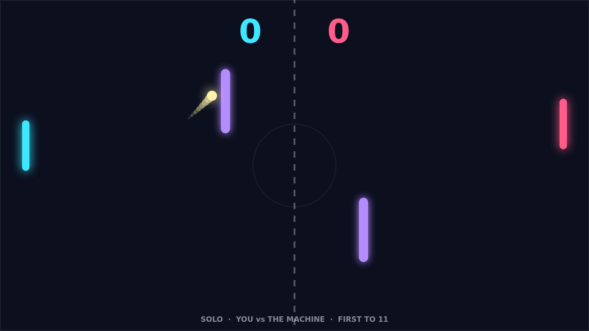
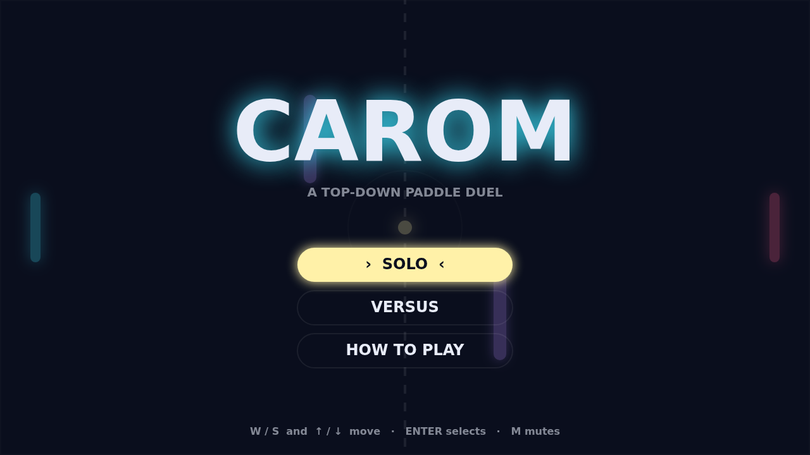

# Carom

Carom is a paddle duel seen from above. You hold one edge of a dark field, your
opponent holds the other, and a bright ball flies between you, kicking off the
top and bottom walls and off two glowing bars that stand in midfield. Lose the
ball past your own edge and the other side scores. First to eleven wins, but
only by two, so a tied game at ten keeps going until someone pulls clear.

The opening rally is honest pong: the serve drifts across at a shallow angle,
you meet it, and where it hits your paddle decides the angle back. Then you try
the thing Carom is really about. Strike the ball while your paddle is moving and
the shot comes off with spin. It leaves straight, and then it starts to bend,
drifting clockwise if you were sweeping downward and the other way if you were
sweeping up. Every paddle hit also makes the ball a little faster, so a long
rally climbs toward a speed where the curve has to be read early.

The two bars are where it gets interesting. They send the ball back without
taking any pace off it, so a shot that would have been an easy save becomes a
bank: curve it into the near bar and it comes off at an angle your opponent was
not covering, or let a ball clip the far bar on its way out of their reach. The
motion trail behind the ball shows exactly how much the flight is bending, which
is also how you learn to read the shots coming at you.

Solo puts you against the machine, which tracks the ball on its side of the net
with a little reaction lag you can exploit with a late curve. Versus seats two
players at one keyboard, left on W and S, right on the arrows. Match point feels
earned either way: the serves keep coming toward whoever was just scored on,
and the last point of a deuce rally, banked off a bar with the ball at full
speed, is the shot you will be trying to pull off again next game.

